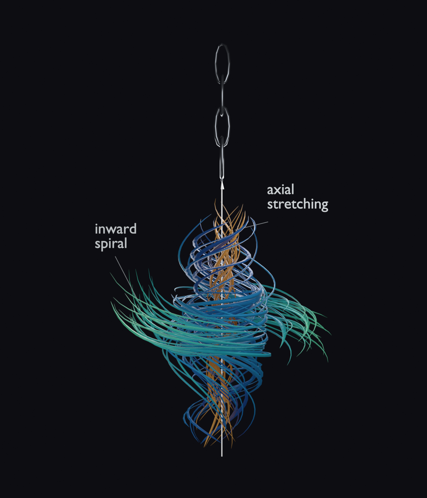

# Navier–Stokes VRChat イヤリング

Navier–Stokes 渦モデルを使った、スキニング対応のVRChat向けイヤリングです。導入者向けunitypackage、編集可能なUnityアセット、Blenderソースとプレビューを公開しています。

## ダウンロードと導入

- **[最新リリースをダウンロード](https://github.com/Nlkomaru/navier-stokes-vrchat/releases/latest)**
- リポジトリ内のunitypackage: [`Deliverables/navier-stokes-earring.unitypackage`](Deliverables/navier-stokes-earring.unitypackage)

Unity **2022.3.22f1** と、VRChat SDK Avatars **3.10.6**、lilToon **2.4.1**、Modular Avatar **1.18.7**（NDMF **1.14.8**）が必要です。依存パッケージやアバターは同梱していません。依存を導入してからunitypackageをインポートしてください。配布パッケージに開発用スクリプトはなく、Unity上部に開発者メニューは追加されません。

1. 大きめの獣耳向け `NavierStokes_Earring_Kemomimi` または通常の人耳向け `NavierStokes_Earring_Human` を、アバターの耳ボーン（または耳・頭に追従するTransform）の子に配置します。
2. Prefabの原点はチェーン上端です。耳穴に合わせて移動・回転し、静止姿勢で下へ垂れるよう調整します。Prefabはアバター固有の位置を持たず、アバターごとにフィットを確認してください。
3. Modular AvatarがメニューとFXを統合します。`Navier-Stokes → Annotations` で注釈文字と引き出し線を切り替えられます。初期状態はON、アバター／ワールド切替をまたいで状態は保存されません。複数配置時はAuto Renameにより各個体が独立した切替になります。

| サイズ | 渦本体 | チェーン | ピアスからの全長目安 |
| --- | ---: | ---: | ---: |
| Kemomimi | 100 mm | 50 mm | 約150 mm |
| Human | 46 mm | 23 mm | 約69 mm |

PhysBone設定は参照アクセサリーのプロファイルを引き継いでいます。獣耳用は kemomimi 値、人耳用は Sio シーンの上書き値です。数値は[パッケージ内README](Unity/Assets/Nikomaru/NavierStokes/README.md)の表を参照してください。実際の揺れ・装着位置・干渉はアバター環境に応じて調整してください。

チェーンは交互に配置した4個の簡素な楕円リンクと先端アイレットで、合計480 trisです。渦本体はBlenderソースで19,770 tris、Unityインポート後は19,767 trisです。注釈メッシュは合計2,246 trisで、本体とチェーンのカウントに含みません。低ポリゴン形状のため、曲率の強い箇所には角張りが残ります。

## 配布ファイルの確認

リポジトリ内の [`Deliverables/SHA256SUMS`](Deliverables/SHA256SUMS) にunitypackageのSHA-256値を記録しています。これは配布物の同一性確認用で、VRChat内の動作やアバター別適合を保証するものではありません。

## 編集・開発用ソース

- Blenderソース: [`Source/NavierStokes_Earring.blend`](Source/NavierStokes_Earring.blend)
- 編集可能なUnityアセット（`.meta`を含む）: [`Unity/Assets/Nikomaru/NavierStokes/`](Unity/Assets/Nikomaru/NavierStokes/)
- Unityエディタ開発ツール（通常の配布アセットではありません）: [`Tools/UnityEditor/`](Tools/UnityEditor/)
- 生成スクリプト: [`build_earring.py`](build_earring.py)、[`generate_vortex.py`](generate_vortex.py)
- プレビュー: [チェーン接続部](previews/earring_chain_closeup.png) · [注釈ON](previews/annotations-on.png) · [注釈OFF](previews/annotations-off.png) · [骨変形](previews/bone-motion.png)

Blenderで再生成する場合は `build_earring.py` と `generate_vortex.py` を同じ場所に置き、アバター作業用Unityプロジェクトとは別の使い捨てプロジェクトを使ってください。実行時は必ず `--project` で対象Unityプロジェクトを明示します（例: `blender -b --python build_earring.py -- --project <使い捨てのUnityプロジェクト>`。既定の出力先に依存しないでください）。Unityアセットを編集するには `Unity/Assets/Nikomaru/NavierStokes/` の中身を初期化済みUnityプロジェクトの `Assets/Nikomaru/NavierStokes/` へコピーします。エディタツールが必要な開発時に限り、`Tools/UnityEditor/` の中身を使い捨てプロジェクトの `Assets/Nikomaru/NavierStokes/Editor/` にコピーしてください。UnityEditor用コードのため、`Assets` 直下や配布アセットの場所へは置かず、通常導入にも含めません。

UnityのBuildを行う使い捨てプロジェクトには必要な依存パッケージ（Unity、VRChat SDK Avatars、lilToon、Modular Avatar/NDMF）を導入してください。Blenderで生成したSource一式を対象プロジェクトに用意し、リポジトリの [`HANDOVER.md`](HANDOVER.md) も `Source/HANDOVER.md` としてコピーしてからBuildを実行します。

**注意:** `NavierStokesSmoke` はデモシーンを開き、元のシーンへ戻しません。アバター作業中のUnityプロジェクトでは実行せず、使い捨ての開発プロジェクトだけで使用してください。実行時の検証証跡はAnimator・スキニング・レンダーの確認であり、VRChatクライアント内のPhysBone、つかみ、アップロード、各アバターでの装着確認を証明するものではありません。

以前の開発版を導入していた場合のみ、UnityのProject欄から `Assets/Nikomaru/NavierStokes/Editor/NavierStokesBuilder.cs` と `NavierStokesSmoke.cs` の**2ファイルだけ**を削除してください。`Assets/Nikomaru` 全体や他の製品ファイルは削除しないでください。更新用packageのインポートでは旧ファイルは自動削除されません。

## ライセンスと非提携

本プロジェクトは [GPL-3.0-only](LICENSE) で提供します。第三者依存パッケージには各々のライセンスが適用されます。参照画像や第三者アバター資産は同梱していません。本プロジェクトはOpenAI、VRChat、または依存パッケージの開発元による公式・公認プロジェクトではありません。
